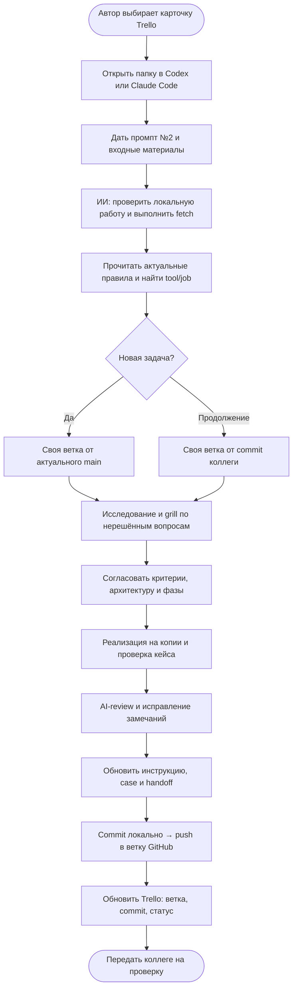

# Новая задача или продолжение

- Параллельные чаты — отдельные worktree; одна сцена Blender/Max — один управляющий агент.
- Субагенты получают независимые подзадачи и непересекающиеся области записи; если недоступны — последовательная работа.
- Fetch получает изменения, но не обновляет рабочие файлы. Commit без push коллега не увидит.
- Автору не обязательно открывать PR сразу. PR нужен для включения в main.

[Промпт №2](../../prompts/02-start-or-continue.md) · [Проверка коллегой](03-peer-review.md) · [Все схемы](README.md)
