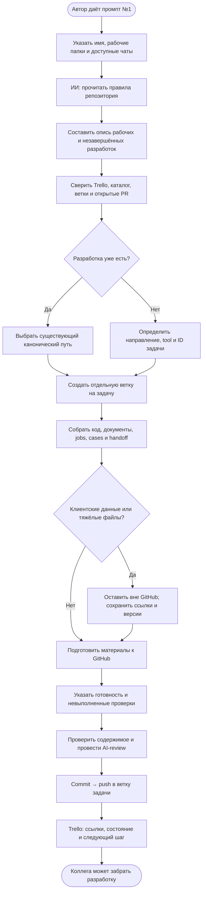

# Первая выгрузка наработок

Собираем рабочие и незавершённые результаты. Не удаляем и не перемещаем исходные файлы. Недоступные чаты не считаем прочитанными. Не переписываем алгоритм ради упаковки.

Пример нового пути: `tools/collisions/ground-ucx/`.
Внутри: `src/`, `docs/`, `jobs/`, `cases/`, `tests/`, `README.md`, `resources.md` — по необходимости.

[Промпт №1](../../prompts/01-collect-local-work.md) · [Все схемы](README.md)
