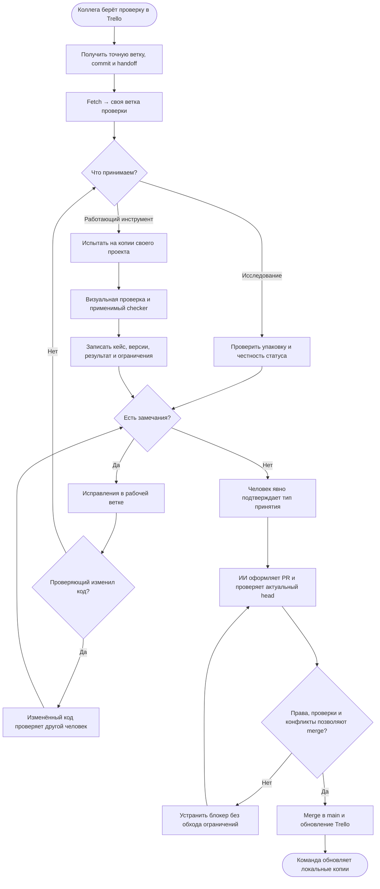

# Проверка коллегой и включение в main

**Два разных результата:**
- Принята упаковка: исследование хранится в main со статусом `research` / `prototype`; инструмент не объявляется готовым.
- Принята функциональность: `accepted` для проверенной области и версии. Карточка готова, только если её критерии выполнены.

Решение принимает проверяющий коллега; отдельное одобрение координатора не требуется. AI-review не заменяет человека.
После изменения кода повторяются относящиеся проверки. Мелкие правки инструкции без изменения поведения проверяющий может принять сам.

[Правила команды](../../process/team-workflow.md) · [Шаблон отчёта](../../templates/review.md) · [Все схемы](README.md)
